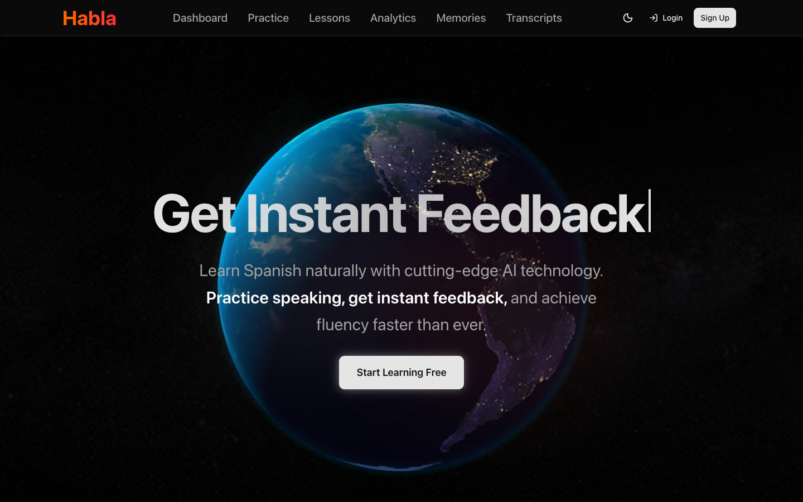

# Habla

An AI Spanish tutor that you talk to. Habla gives you a voice conversation partner in the browser or on a real phone call. It writes reading lessons at your level and keeps track of your progress. The tutor remembers what you tell it between sessions.

**Live:** https://habla-two.vercel.app



## Features

- **Voice practice.** Talk with a Spanish tutor built on ElevenLabs Conversational AI, right on the Practice page.
- **Phone calls.** Habla can call your phone so you can practice away from the screen. Calls can also be scheduled (daily, weekdays, weekly or every two weeks, at a set time in your timezone).
- **Transcripts.** Every conversation is saved, and you can read back the transcript and replay the audio.
- **Memories.** Add facts about yourself, such as your job, trip plans or interests. They are stored in the agent's knowledge base so the tutor can bring them up later.
- **Reading lessons.** Pick a topic and a level. Gemini writes a 300 to 500 word Spanish article in sections. It is read aloud with the text highlighted as it's spoken, using ElevenLabs timestamped TTS. A vocabulary mini-game runs while the article generates. Then you write a summary that Gemini grades on accuracy, grammar, vocabulary and coherence, and take a generated quiz.
- **Progress.** A dashboard with your practice streak, plus analytics over lesson attempts and scores.
- **Accounts.** Supabase auth (email/password or Google) with a profile: name, phone number and the languages you're learning.

## Architecture

```
Browser (Next.js 15, React 19)
  ├─ ElevenLabs ConvAI widget ───────────────▶ ElevenLabs agent
  ├─ /api/call ──────▶ ElevenLabs + Twilio outbound call ──▶ your phone
  ├─ /api/conversations ─▶ ElevenLabs conversation history + audio
  ├─ /api/knowledge-base ─▶ ElevenLabs knowledge base (memories)
  ├─ /api/gemini ─────▶ Gemini 2.5 Flash (article, quiz, summary grading)
  └─ Supabase ────────▶ auth, profiles, lessons, quiz_questions, lesson_attempts

Supabase pg_cron (hourly) ─▶ trigger_scheduled_calls() ─▶ /api/call-scheduled
```

- **Scheduled calls.** These run entirely in the database. An hourly `pg_cron` job checks each profile's schedule and timezone, then calls back into the app's `/api/call-scheduled` route, which starts the outbound call. See `supabase/migrations/003` to `007`.
- **Route protection.** Next.js middleware checks the Supabase session and sends logged-out users to `/login`.
- **Streaks.** The `record_daily_activity` and `get_streak_count` Postgres functions compute streaks from an array of activity dates on the profile.

## Stack

Next.js 15 (App Router, Turbopack), React 19, TypeScript, Tailwind CSS 4, shadcn/ui, Supabase (Postgres, auth, pg_cron), ElevenLabs (Conversational AI, Twilio calls, TTS), Google Gemini, Spline for the 3D globe, deployed on Vercel.

## Running it

```bash
npm install
cp .env.example .env.local   # fill in the keys below
npm run dev                  # http://localhost:3000
```

| Variable | Used for |
| --- | --- |
| `NEXT_PUBLIC_SUPABASE_URL`, `NEXT_PUBLIC_SUPABASE_ANON_KEY` | Auth and data |
| `GEMINI_API_KEY` | Lesson generation and grading |
| `ELEVENLABS_API_KEY` | Calls, transcripts, memories |
| `ELEVENLABS_AGENT_ID` | Agent that memories are attached to |
| `ELEVENLABS_PHONE_NUMBER_ID` | Twilio number linked in ElevenLabs, for outbound calls |
| `ELEVENLABS_AUTO_ATTACH_KNOWLEDGE` | Optional. Set to `false` to stop attaching memories to the agent automatically |

**Database.** Run the SQL files in `supabase/migrations/` in order in the Supabase SQL editor. Scheduled calls need the `pg_cron` and `http` extensions enabled. Point `app_config.api_url` at your deployment (or at localhost) as described in `007_set_api_url.sql`.

## License

Apache 2.0. See [LICENSE](LICENSE).
